# Local Business Templates

Twelve modern website templates for local businesses. Every template is a separate, named theme and ships as a **Shopify Online Store 2.0 theme** and as a **Squarespace Developer Platform template**, both generated from one shared source.

| Template | Desktop | Mobile |
|---|---|---|
| **Atelier**<br>Minimalist · <sub>Quiet, editorial and crafted</sub><br><sub>Demo: Kiln & Clay</sub> |  |  |
| **Nebula**<br>Futuristic · <sub>Dark, glowing and high-tech</sub><br><sub>Demo: Voltline</sub> |  |  |
| **Aurum**<br>Luxury · <sub>Black, gold and unhurried</sub><br><sub>Demo: Maison Aurelle</sub> | 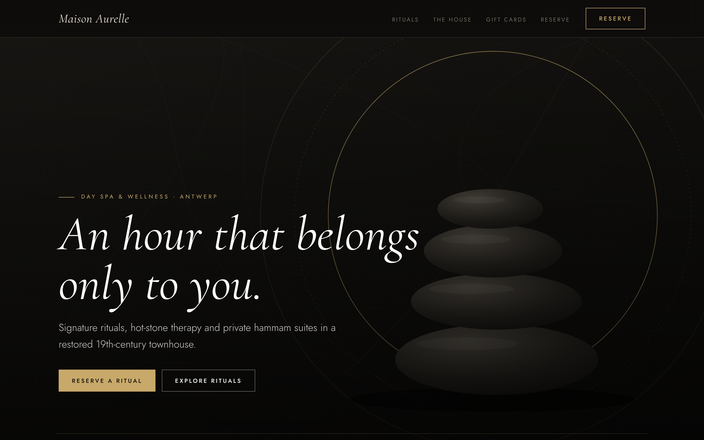 | 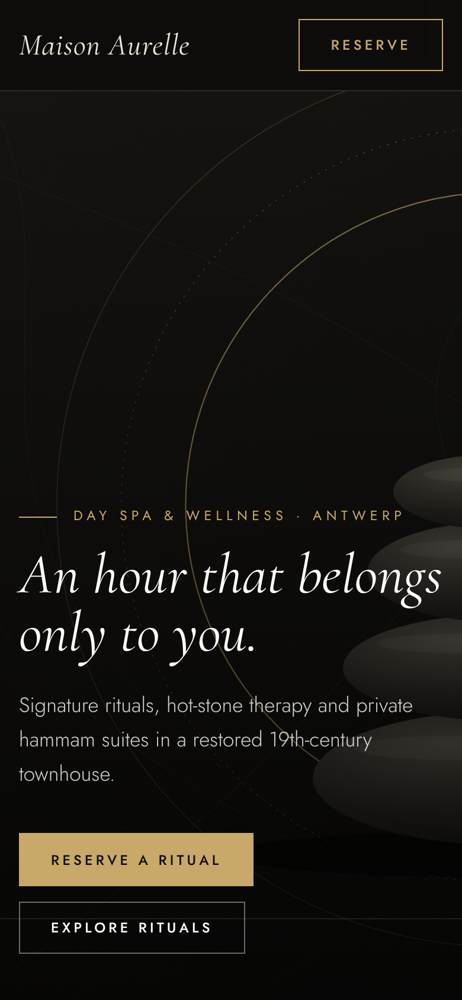 |
| **Monolith**<br>Brutalist · <sub>Loud, raw and unapologetic</sub><br><sub>Demo: GRND.</sub> |  | 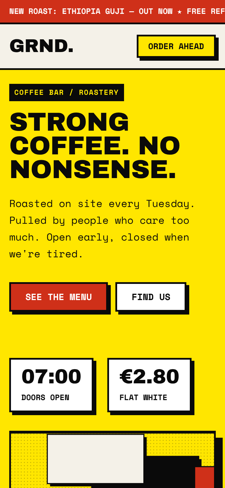 |
| **Meridian**<br>Professional · <sub>Clear, credible and data-led</sub><br><sub>Demo: Harbor & Pine</sub> |  |  |
| **Camellia**<br>Elegant · <sub>Soft, romantic and refined</sub><br><sub>Demo: Petal & Stem</sub> | 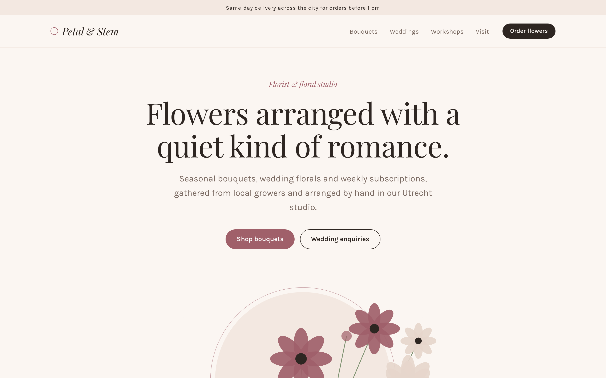 | 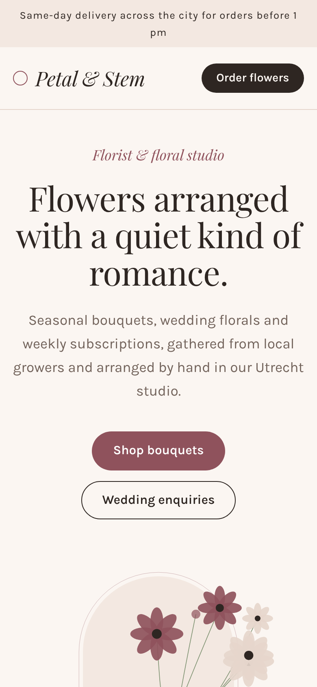 |
| **Marigold**<br>Friendly · <sub>Warm, playful and welcoming</sub><br><sub>Demo: Happy Paws</sub> | 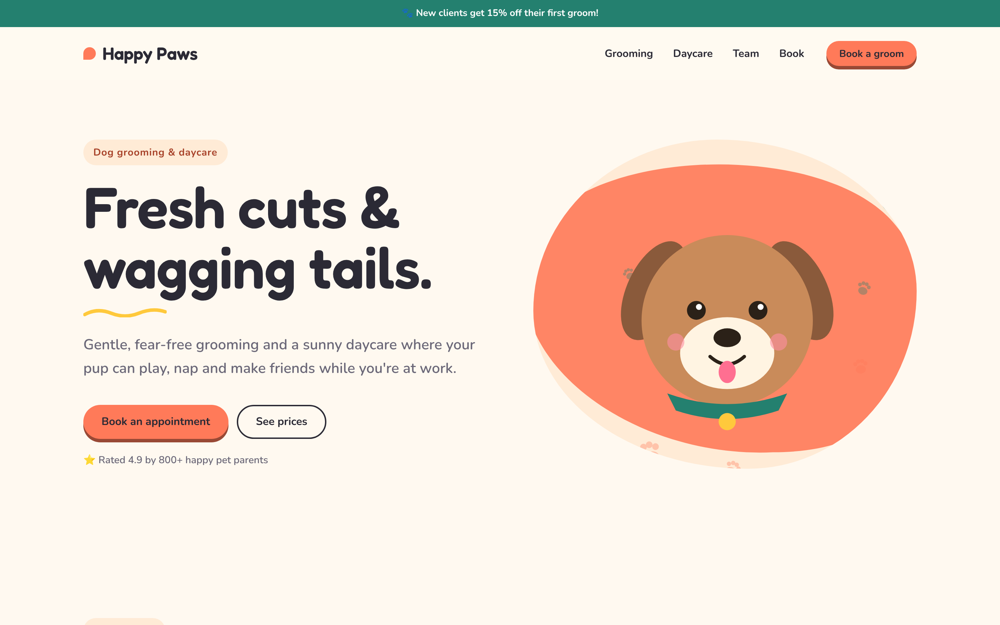 |  |
| **Terroir**<br>Organic · <sub>Earthy, textured and seasonal</sub><br><sub>Demo: Hearth & Field</sub> | 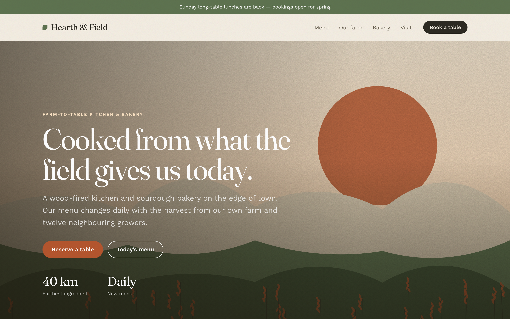 | 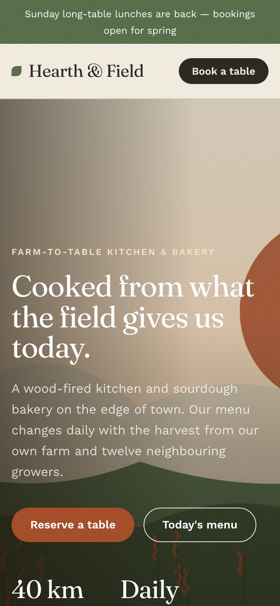 |
| **Pulse**<br>Athletic · <sub>Bold, kinetic and community-first</sub><br><sub>Demo: Forge Athletic Club</sub> | 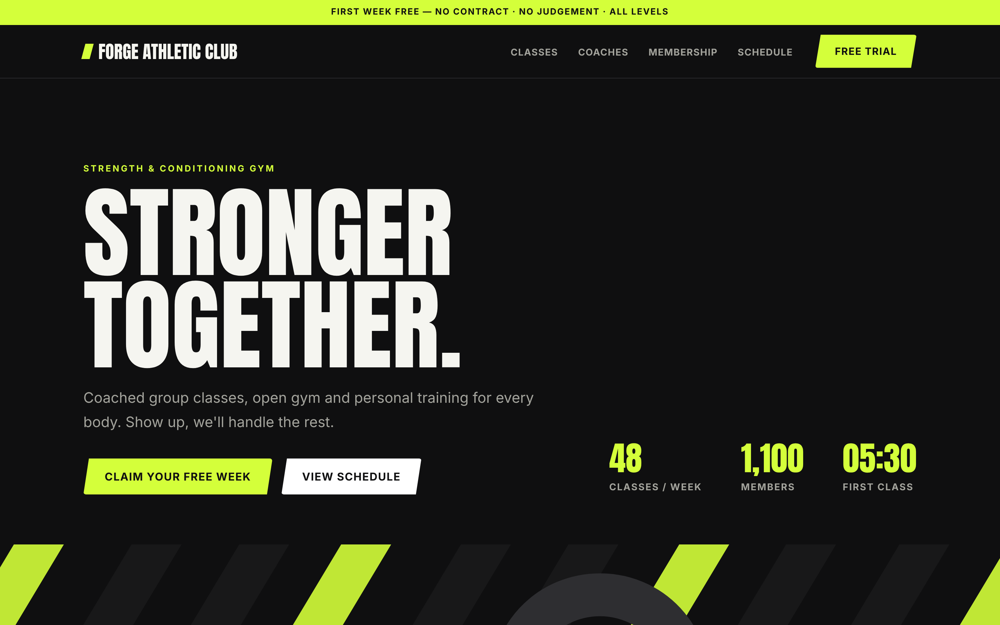 |  |
| **Tessera**<br>Bento · <sub>Modular, soft and modern</sub><br><sub>Demo: Studio Verve</sub> | 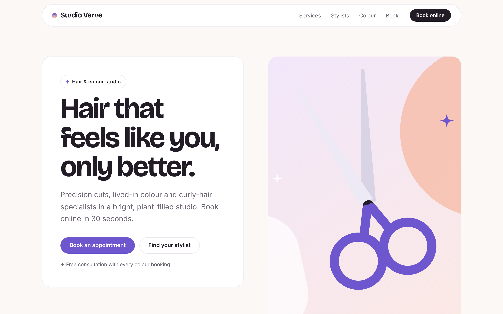 | 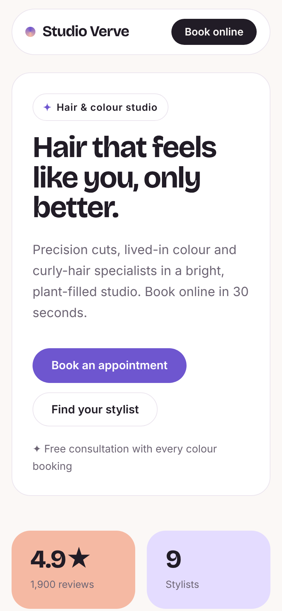 |
| **Sundown**<br>Retro · <sub>Warm, groovy and nostalgic</sub><br><sub>Demo: Groove Theory</sub> | 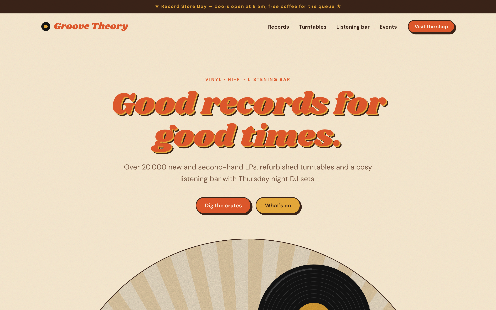 | 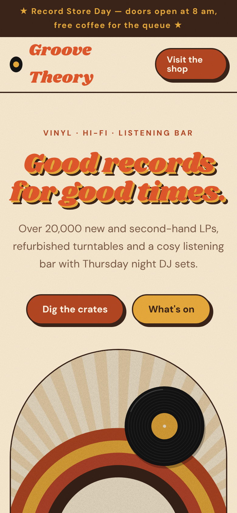 |
| **Folio**<br>Editorial · <sub>Type-led, Swiss and architectural</sub><br><sub>Demo: Studio Kade</sub> | 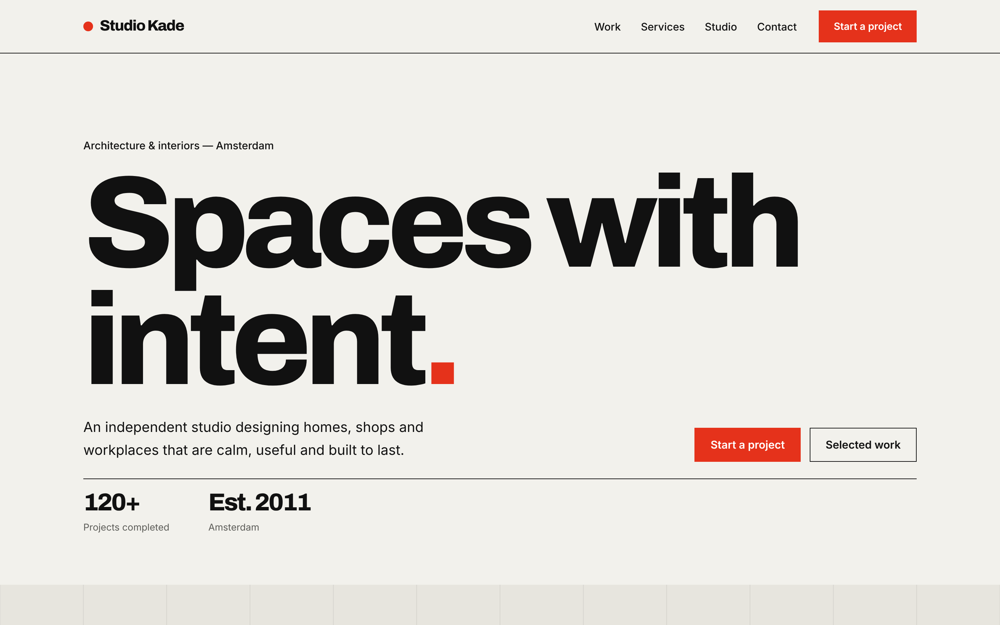 | 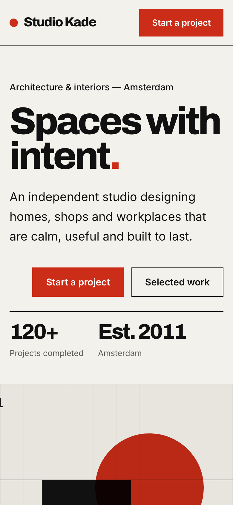 |

Full-page captures live in `screenshots/<template>/full.png`.

### Inspiration for the 2026 additions
The last five templates draw on themes that 2026 design roundups keep repeating:
- **Terroir:** grain and texture, as a counter to AI-polished visuals.
- **Tessera:** a bento-grid services layout, added as a new `bento` layout option that every template can use.
- **Folio:** type-led editorial design.
- **Sundown:** retro nostalgia.
- **Pulse:** gym sites that lead with community rather than intimidation.

## How it works

```
packages/
  core/          shared source of truth
    sections.js  every section (header, hero, services, about, gallery, testimonials, visit, contact, footer), written once
    context.js   platform contexts: Liquid for Shopify, static HTML for Squarespace and the preview
    base.css     layout and components, driven by CSS custom properties (tokens)
    art.js       procedural SVG placeholder art in each style's palette
  shopify/       theme generator (layout, sections with schema, JSON templates, commerce pages)
  squarespace/   template generator (template.conf, site.region, navigation block, LESS tweaks, homepage)
  preview/       static HTML preview (used for the screenshots)
styles/<template>/
  style.json     name, style, tokens (colours, fonts), section layout variants, demo content
  style.css      personality on top of the base
scripts/         build, validate, theme-check, a11y, screenshots, package, fonts
docs/            THEME_STORE.md, SQUARESPACE.md
```

A section is a single template function. Its output goes through a context object (`c.t('heading')`, `c.each(...)`, `c.img(...)`), which emits one of:
- **Shopify:** `{{ section.settings.heading | escape }}`, ``, plus a generated ``. Defaults come from the style's demo content, so a fresh install looks like the screenshot.
- **Squarespace and the preview:** the demo content baked in as HTML.

Adding or changing a section in `sections.js` therefore updates all 12 templates on both platforms.

## Commands

Requires Node 20+. Run `npm install` once. Screenshots and the accessibility audit also need Playwright: `npm i -D playwright && npx playwright install chromium`.

```bash
npm run build          # dist/{shopify,squarespace,preview}/<template>/ + dist/shopify/local (Theme Store build)
```
```bash
npm run check          # repo checks + Shopify Theme Check + WCAG 2.1 AA audit
```
```bash
npm run screenshots    # screenshots/<template>/{desktop,full,mobile}.png
```
```bash
npm run package        # dist/packages/shopify-<template>.zip and shopify-local.zip
```

To build one template only, pass its name, e.g. `node scripts/build.mjs aurum`.

## Selling

```bash
npm run build && npm run screenshots && npm run release   # dist/release/
```

For every template, `dist/release/` holds `<Name>-v1.0.0.zip`, the file the buyer downloads. It contains:
- the Shopify theme
- the Squarespace 7.1 design kit: custom CSS, fonts, JPG artwork and a step-by-step build guide
- the Squarespace 7.0 Developer template
- the Wix Studio design kit: global.css, fonts, artwork and a build guide
- `Documentation.html`, `LICENSE.txt`, `CHANGELOG.md` and screenshots

Alongside them are a `<Name>-LISTING.md` with marketplace copy, an all-templates bundle and the Theme Store submission zip. Put your brand, website, support email and prices in `release.config.json` first. Until you do, only `npm run release:draft` works.

- **Shopify Theme Store:** submit the single theme *Local*, which carries all 12 designs as presets. [docs/THEME_STORE.md](docs/THEME_STORE.md) lists what's already verified and the remaining manual steps.
- **Squarespace:** read [docs/SQUARESPACE.md](docs/SQUARESPACE.md) first. Code templates only run on 7.0 sites.
- **Wix:** read [docs/WIX.md](docs/WIX.md). Wix templates are built in the editor, so this repo ships a design kit plus a guide.

## Installing

### Shopify
1. Run `npm run build` and then `npm run package`.
2. In Shopify admin go to **Online Store → Themes → Add theme → Upload zip file**, and pick `dist/packages/shopify-<template>.zip`.
   You can also run `shopify theme push --path dist/shopify/<template>`.
3. In the theme editor:
   - Every section, text, button, layout variant (for example hero *split / stacked / centered / full*) and opening-hours row can be edited.
   - **Theme settings → Style** switches between all 12 designs.
   - **Colors** holds 3 colour schemes, which any section can use.
   - Uploading an image replaces the bundled placeholder art.
4. The contact form uses Shopify's built-in `contact` form, so messages go to the store email.

### Squarespace (Developer Platform, 7.0)
1. Enable **Developer Mode** on the site and clone its template repo.
2. Copy `dist/squarespace/<template>/*` into that repo, then commit and push.
3. **Design → Style Editor** exposes every colour as a tweak.
4. The homepage is `pages/home.page`; set it as the homepage under **Pages**. All other pages use normal Squarespace content and inherit the styling.
5. Static pages have no form backend, so the contact section links to email and phone. Add a Squarespace Form block on a regular page if you need a form.

## Adding a style
1. Copy `styles/atelier` to `styles/<new-template>`.
2. Edit the tokens and content in `style.json` and the personality CSS in `style.css`. Pick an art `motif`, or add one to `packages/core/art.js`.
3. Run `npm run build && npm run screenshots`.

## Notes / limitations
- The placeholder imagery is procedural SVG, so there are no stock-photo licences to manage. Swap in real photos per site.
- Fonts are self-hosted, with no Google Fonts requests. All of them are SIL Open Font License.
- Every build passes Shopify Theme Check with 0 offenses and an axe-core WCAG 2.1 AA audit with 0 violations. None has been uploaded to a live Shopify store or Squarespace site yet, so do one real upload per platform before selling.
