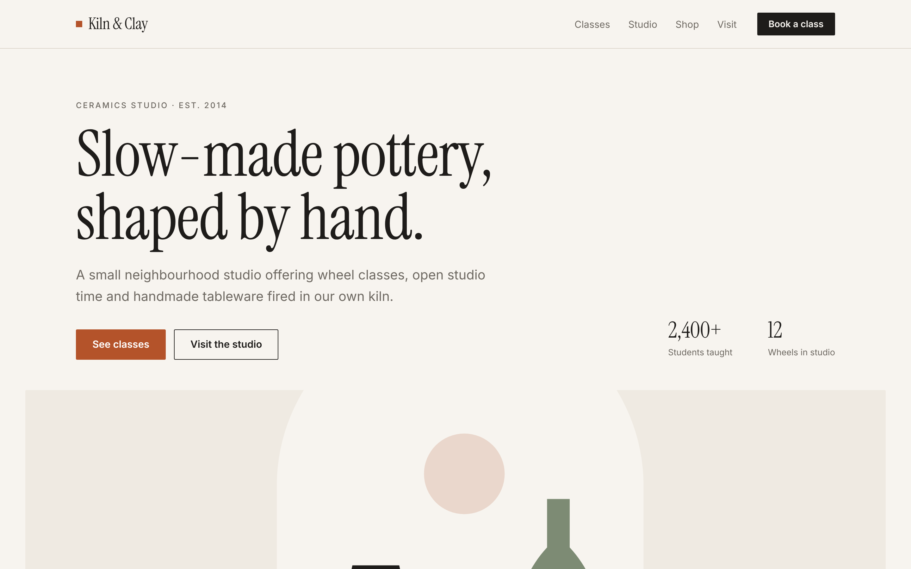
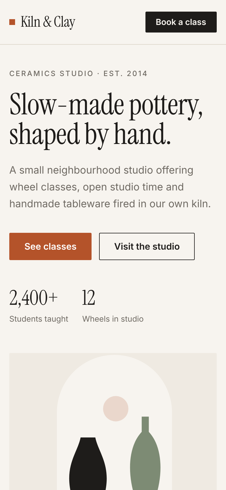
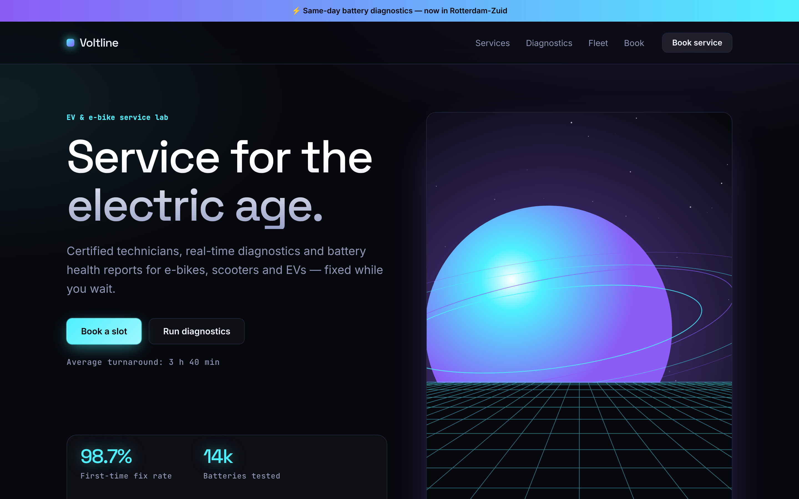
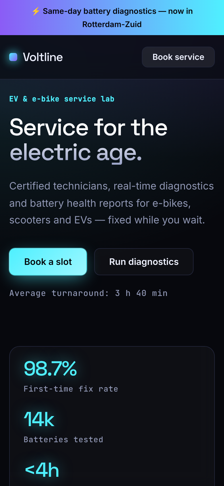
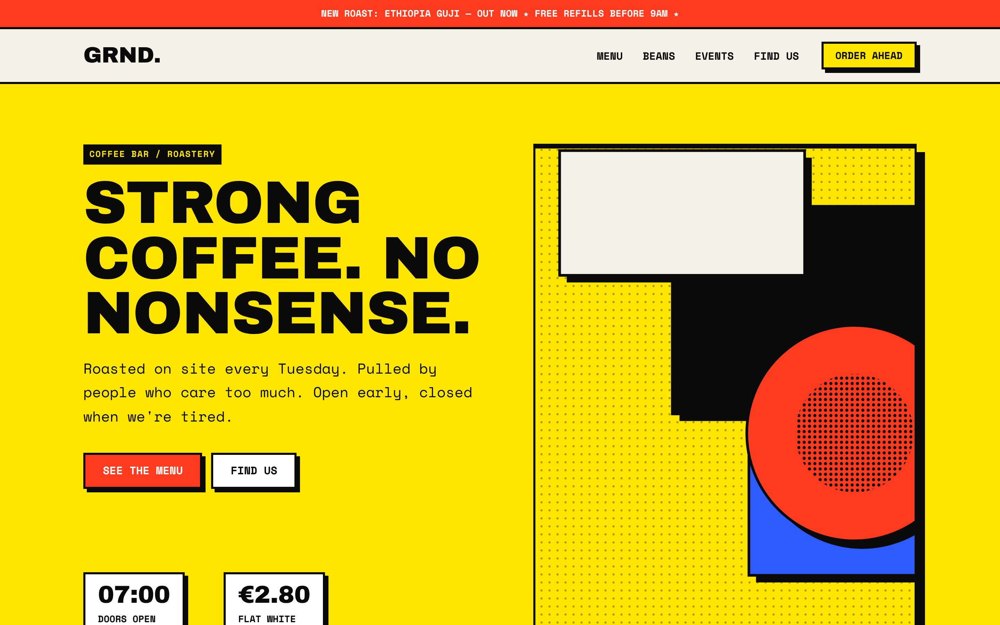
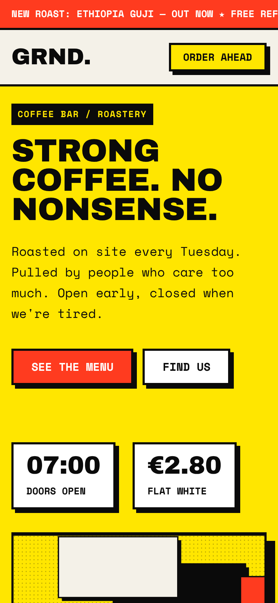
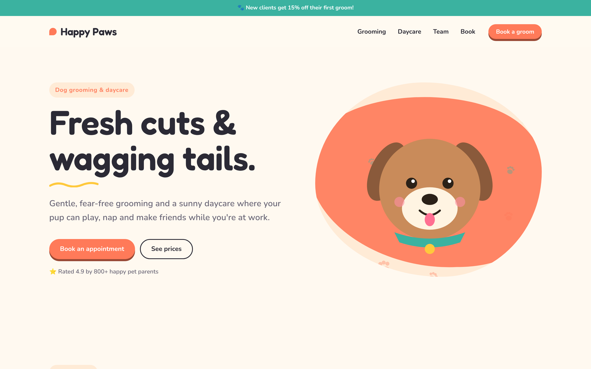
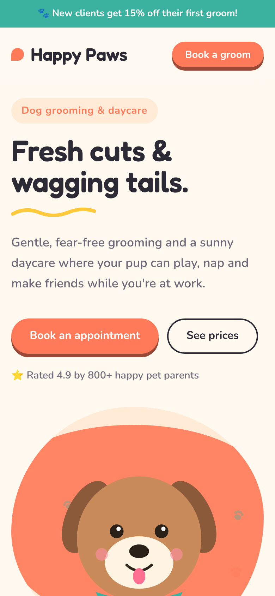

# Local Business Templates

Seven modern website templates for local businesses. Each one ships as a **Shopify Online Store 2.0 theme** and as a **Squarespace Developer Platform template**, both generated from one shared source.

| Style | Desktop | Mobile |
|---|---|---|
| **Minimalist**<br>Kiln & Clay — ceramics studio<br><sub>Warm paper tones, editorial serif, hairline rules</sub> |  |  |
| **Futuristic**<br>Voltline — EV & e-bike service lab<br><sub>Dark UI, neon gradients, glass cards, mono labels</sub> |  |  |
| **Luxury**<br>Maison Aurelle — day spa<br><sub>Black & gold, italic Cormorant, full-bleed hero</sub> |  |  |
| **Brutalist**<br>GRND. — coffee bar & roastery<br><sub>Hard shadows, 3px borders, primary colours, mono type</sub> |  |  |
| **Professional**<br>Harbor & Pine — accounting firm<br><sub>Navy & blue, data visuals, trust signals</sub> |  |  |
| **Elegant**<br>Petal & Stem — florist<br><sub>Blush palette, Playfair, arched frames</sub> |  |  |
| **Friendly**<br>Happy Paws — dog grooming<br><sub>Rounded shapes, playful colours, illustrated mascot</sub> |  |  |

Full-page captures live in `screenshots/<style>/full.png`.

## How it works

```
packages/
  core/          shared source of truth
    sections.js  every section (header, hero, services, about, gallery, testimonials, visit, contact, footer), written once
    context.js   platform contexts: Liquid for Shopify, static HTML for Squarespace and the preview
    base.css     layout and components, driven by CSS custom properties (tokens)
    art.js       procedural SVG placeholder art in each style's palette
  shopify/       theme generator (layout, sections with schema, JSON templates, commerce pages)
  squarespace/   template generator (template.conf, site.region, navigation block, LESS tweaks, homepage)
  preview/       static HTML preview (used for the screenshots)
styles/<style>/
  style.json     tokens (colours, fonts), section layout variants, demo content
  style.css      personality on top of the base
scripts/         build, validate, screenshots, package
```

A section is a single template function. Its output goes through a context object (`c.t('heading')`, `c.each(...)`, `c.img(...)`), which emits one of:
- **Shopify:** `{{ section.settings.heading | escape }}`, ``, plus a generated ``. Defaults come from the style's demo content, so a fresh install looks like the screenshot.
- **Squarespace and the preview:** the demo content baked in as HTML.

Adding or changing a section in `sections.js` therefore updates all 7 styles on both platforms.

## Commands

Requires Node 20+. Screenshots also need Playwright (`npm i -D playwright`).

```bash
npm run build          # dist/{shopify,squarespace,preview}/<style>/
```
```bash
node scripts/validate.mjs   # structural checks on every generated theme
```
```bash
npm run screenshots    # screenshots/<style>/{desktop,full,mobile}.png
```
```bash
npm run package        # dist/packages/shopify-<style>.zip
```

To build one style only, pass its name, e.g. `node scripts/build.mjs luxury`.

## Installing

### Shopify
1. Run `npm run build` and then `npm run package`.
2. In Shopify admin go to **Online Store → Themes → Add theme → Upload zip file**, and pick `dist/packages/shopify-<style>.zip`.
   You can also run `shopify theme push --path dist/shopify/<style>`.
3. In the theme editor:
   - Every section, text, button, layout variant (for example hero *split / stacked / centered / full*) and opening-hours row can be edited.
   - Colours are under **Theme settings → Colors**.
   - Uploading an image replaces the bundled placeholder art.
4. The contact form uses Shopify's built-in `contact` form, so messages go to the store email.

### Squarespace (Developer Platform, 7.0)
1. Enable **Developer Mode** on the site and clone its template repo.
2. Copy `dist/squarespace/<style>/*` into that repo, then commit and push.
3. **Design → Style Editor** exposes every colour as a tweak.
4. The homepage is `pages/home.page`; set it as the homepage under **Pages**. All other pages use normal Squarespace content and inherit the styling.
5. Static pages have no form backend, so the contact section links to email and phone. Add a Squarespace Form block on a regular page if you need a form.

## Adding a style
1. Copy `styles/minimalist` to `styles/<new-style>`.
2. Edit the tokens and content in `style.json` and the personality CSS in `style.css`. Pick an art `motif`, or add one to `packages/core/art.js`.
3. Run `npm run build && npm run screenshots`.

## Notes / limitations
- The placeholder imagery is procedural SVG, so there are no stock-photo licences to manage. Swap in real photos per site.
- Fonts load from Google Fonts on both platforms.
- The generated output has been checked with `scripts/validate.mjs`. It has not yet been uploaded to a live Shopify store or Squarespace site. Before shipping, do one real upload per platform and run `npx @shopify/theme-check-node dist/shopify/<style>`.
